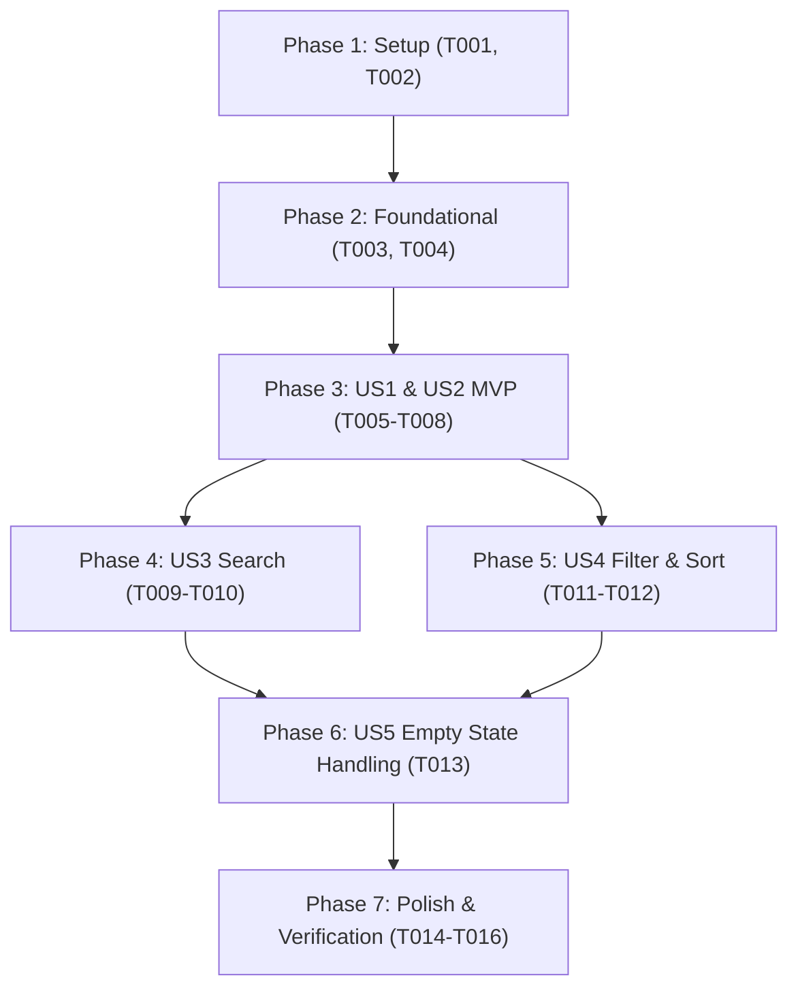

# Tasks: PT Client List Pagination, Search, and Filtering

**Input**: Design documents from `specs/001-pt-client-list/`  
**Prerequisites**: [plan.md](plan.md), [spec.md](spec.md), [research.md](research.md), [data-model.md](data-model.md), [contracts/pt-client-list-api.json](contracts/pt-client-list-api.json), [quickstart.md](quickstart.md)  
**Organization**: Tasks are grouped by user story to enable independent implementation and testing of each story.

## Format: `[ID] [P?] [Story] Description`

- **[P]**: Can run in parallel (different files, no dependencies)
- **[Story]**: Which user story this task belongs to (e.g., US1, US2, US3, US4, US5)
- Include exact file paths in descriptions

---

## Phase 1: Setup (Shared Infrastructure)

**Purpose**: Project DTO initialization and request/response structures

- [x] T001 Create query DTO `GetPtClientsQuery.java` in `src/main/java/x10/zenfit/mvp/service/service/clientService/getPtClientsUc/GetPtClientsQuery.java` with verbatim constraints: `trainerId` (mandatory String), `page` (int, default 1, min 1), `size` (int, fixed 8), `search` (optional String), `status` (optional `ClientStatus`), `sortBy` (default "createdAt", allowed: "createdAt", "fullName"), and `sortDirection` (default "DESC", allowed: "ASC", "DESC")
- [x] T002 [P] Create pagination response DTO `PaginatedClientResponse.java` in `src/main/java/x10/zenfit/mvp/service/service/clientService/getPtClientsUc/PaginatedClientResponse.java` containing fields: `items` (`List<ClientResponse>`), `page` (`int`), `size` (`int`), `totalElements` (`long`), `totalPages` (`int`), `hasNext` (`boolean`), `hasPrevious` (`boolean`)

---

## Phase 2: Foundational (Blocking Prerequisites)

**Purpose**: Core data access and repository abstractions that MUST be complete before user stories can query data

- [x] T003 Declare pagination query method `findPtClientsWithPaging` in repository interface `src/main/java/x10/zenfit/mvp/service/Repository/IClientRepository.java` accepting `GetPtClientsQuery` and returning `PaginatedClientResponse`
- [x] T004 Implement `findPtClientsWithPaging` in `src/main/java/x10/zenfit/mvp/service/infrastructure/client/adapter/ClientRepositoryImpl.java` using `MongoTemplate` to construct dynamic `Criteria` (`assignedTrainerId`, optional search regex on `fullName` or `phone`, optional `status`), executing a `count()` query for `totalElements` and a paginated `find()` query with `skip((page - 1) * size)` and `limit(size)` sorted by `sortBy` and `sortDirection`

**Checkpoint**: Foundation ready - data access layer is capable of executing isolated, paginated queries on MongoDB

---

## Phase 3: User Story 1 & User Story 2 - Phân trang 8 học viên & Cô lập dữ liệu PT (Priority: P1) 🎯 MVP

**Goal**: Cho phép PT xem danh sách học viên được gán cho chính mình theo từng trang 8 học viên, kèm tổng số học viên và tổng số trang. Tuyệt đối không để lộ học viên của PT khác.

**Independent Test**: Đăng nhập với tài khoản PT có 10 học viên, gọi `GET /api/clients/my-clients?page=1`; nhận được đúng 8 học viên trang 1, `totalElements = 10`, `totalPages = 2`, `page = 1`, `size = 8`. Gọi tiếp `page=2` nhận được 2 học viên còn lại. 100% học viên đều có `assignedTrainerId` khớp với PT đăng nhập.

- [x] T005 [P] [US1] Create use case interface `IGetPtClientsUc.java` in `src/main/java/x10/zenfit/mvp/service/service/clientService/getPtClientsUc/IGetPtClientsUc.java` defining `PaginatedClientResponse execute(GetPtClientsQuery query)`
- [x] T006 [US1] Implement `GetPtClientsUcImpl.java` in `src/main/java/x10/zenfit/mvp/service/service/clientService/getPtClientsUc/GetPtClientsUcImpl.java` (`@Component`), enforcing fixed page size of 8, normalizing `page < 1` to `1`, delegating to `IClientRepository.findPtClientsWithPaging`, and mapping `ClientEntity` items to `ClientResponse` via `ClientResponseMapper`
- [x] T007 [US2] Declare `getPtClients` in facade interface `src/main/java/x10/zenfit/mvp/service/service/clientService/ICoreClientService.java` and implement delegation in `src/main/java/x10/zenfit/mvp/service/service/clientService/CoreClientServiceImpl.java`
- [x] T008 [US2] Implement `GET /api/clients/my-clients` endpoint in `src/main/java/x10/zenfit/mvp/service/controller/ClientController.java`, extracting authenticated `trainerId` directly from `SecurityContext` via `getCurrentUserId()`, binding query params (`page`, `search`, `status`, `sortBy`, `sortDirection`), delegating to `coreClientService.getPtClients`, and returning `ApiResponse.ok("CLIENT.GET_PAGINATED_SUCCESS", "Lấy danh sách khách hàng phân trang thành công", response)`

**Checkpoint**: User Story 1 & 2 hoàn thành. Hệ thống có MVP đầy đủ cho phép PT xem danh sách học viên phân trang 8 người/trang với tính năng bảo mật cô lập dữ liệu.

---

## Phase 4: User Story 3 - Tìm kiếm khách hàng theo tên hoặc số điện thoại (Priority: P2)

**Goal**: Cho phép PT tìm kiếm nhanh học viên của mình bằng cách nhập một phần họ tên (`fullName`) hoặc số điện thoại (`phone`).

**Independent Test**: Nhập từ khóa "Minh" hoặc "0987" vào tham số `search`, kết quả chỉ trả về các học viên có tên chứa "Minh" hoặc số điện thoại chứa "0987" thuộc PT đó; thông tin phân trang cập nhật lại theo số kết quả tìm được.

- [x] T009 [US3] Add search query normalization (trimming whitespace) and regex construction (`(?i).*keyword.*` across `fullName` OR `phone`) inside `src/main/java/x10/zenfit/mvp/service/infrastructure/client/adapter/ClientRepositoryImpl.java`
- [x] T010 [US3] Ensure `GetPtClientsUcImpl.java` in `src/main/java/x10/zenfit/mvp/service/service/clientService/getPtClientsUc/GetPtClientsUcImpl.java` handles null or empty search strings gracefully without adding empty search filters

**Checkpoint**: User Story 3 hoàn thành. PT có thể tìm kiếm học viên theo tên hoặc SĐT mượt mà trên danh sách phân trang.

---

## Phase 5: User Story 4 - Lọc theo trạng thái và sắp xếp danh sách (Priority: P2)

**Goal**: Cho phép PT lọc học viên theo trạng thái (`ACTIVE`, `INACTIVE`, `POTENTIAL`) và sắp xếp theo ngày tạo (`createdAt`) hoặc tên (`fullName`) theo chiều ASC/DESC.

**Independent Test**: Lọc `status=ACTIVE` và `sortBy=fullName&sortDirection=ASC`; kết quả chỉ chứa học viên ACTIVE sắp xếp theo thứ tự chữ cái A-Z.

- [x] T011 [US4] Implement status filter criteria and dynamic sorting validation in `src/main/java/x10/zenfit/mvp/service/infrastructure/client/adapter/ClientRepositoryImpl.java`, safely mapping `"createdAt"` and `"fullName"` with fallback to `createdAt DESC` when invalid fields are provided
- [x] T012 [US4] Validate query parameters in `src/main/java/x10/zenfit/mvp/service/service/clientService/getPtClientsUc/GetPtClientsUcImpl.java` to ensure sorting direction defaults to `DESC` if not specified

**Checkpoint**: User Story 4 hoàn thành. PT có thể lọc học viên theo trạng thái và đảo chiều sắp xếp linh hoạt.

---

## Phase 6: User Story 5 - Xử lý danh sách rỗng an toàn khi không có kết quả khớp (Priority: P3)

**Goal**: Đảm bảo khi không có học viên nào khớp tiêu chí tìm kiếm/lọc hoặc PT chưa có học viên nào, hệ thống trả về danh sách rỗng (`items: []`, `totalElements: 0`, `totalPages: 0`) với mã 200 OK, tuyệt đối không báo lỗi.

**Independent Test**: Tìm kiếm với từ khóa không tồn tại `search=NotFound999`; nhận mã phản hồi 200 OK với `items: []`, `totalElements: 0`, `totalPages: 0`, `hasNext: false`, `hasPrevious: false`.

- [x] T013 [US5] Implement empty state guard logic in `src/main/java/x10/zenfit/mvp/service/infrastructure/client/adapter/ClientRepositoryImpl.java` and `GetPtClientsUcImpl.java` so that when `totalElements == 0` or `skip >= totalElements`, it returns an empty list with `totalPages = 0` and accurate navigation flags without throwing exceptions

**Checkpoint**: User Story 5 hoàn thành. 100% các trường hợp không tìm thấy dữ liệu đều trả về phản hồi êm đẹp.

---

## Phase 7: Polish & Cross-Cutting Concerns

**Purpose**: Xác thực bảo mật, biên dịch kiểm thử toàn bộ hệ thống và kiểm chứng kịch bản thực tế

- [x] T014 Verify route security authorization in `src/main/java/x10/zenfit/mvp/service/config/security/SecurityConfig.java` to guarantee `/api/clients/my-clients` is properly covered by `hasAnyRole("ADMIN", "HEAD_OF_TRAINING", "TEAM_MANAGER", "PT", "STAFF")`
- [x] T015 Execute Maven compilation command `./mvnw compile -DskipTests` to verify zero compile errors across all modified and newly created classes
- [x] T016 Validate the 5 end-to-end scenarios documented in `specs/001-pt-client-list/quickstart.md`

---

## Dependencies & Execution Order

### Phase Dependencies

- **Setup (Phase 1)**: Không phụ thuộc - có thể bắt đầu ngay.
- **Foundational (Phase 2)**: Phụ thuộc vào Phase 1 - BLOCKS các user stories tiếp theo.
- **User Story 1 & 2 (Phase 3 - MVP)**: Phụ thuộc vào Phase 2.
- **User Story 3 (Phase 4)**: Phụ thuộc vào Phase 3 hoàn thành.
- **User Story 4 (Phase 5)**: Phụ thuộc vào Phase 3 hoàn thành (có thể chạy song song với Phase 4).
- **User Story 5 (Phase 6)**: Phụ thuộc vào Phase 3, 4, 5 hoàn thành.
- **Polish (Phase 7)**: Chạy sau khi tất cả các User Stories hoàn tất.

### User Story Dependencies

### Parallel Opportunities

- **Trong Phase 1**: `T001` (Query DTO) và `T002` (Response DTO) có thể viết song song.
- **Sau Phase 3**: Phase 4 (Tìm kiếm) và Phase 5 (Lọc & Sắp xếp) tác động vào các nhánh logic truy vấn độc lập và có thể chạy song song.
- **Trong Phase 7**: `T014` (Security check) và `T015` (Maven build) có thể kiểm tra song song.

---

## Implementation Strategy

### MVP First (Phát hành cốt lõi trước)
1. Hoàn thành Phase 1 & Phase 2: DTOs và MongoTemplate paginated data access.
2. Hoàn thành Phase 3: Controller endpoint `GET /api/clients/my-clients` với phân trang 8 học viên và trích xuất `trainerId` bảo mật từ `SecurityContext`.
3. **Kiểm thử độc lập MVP**: Kiểm tra PT xem đúng 8 học viên trang 1 và chuyển trang 2.

### Tăng trưởng tính năng (Incremental Delivery)
4. Mở rộng Phase 4: Bổ sung tìm kiếm kép họ tên và số điện thoại.
5. Mở rộng Phase 5: Bổ sung bộ lọc trạng thái và sắp xếp theo ngày/tên.
6. Hoàn thiện Phase 6 & 7: Xử lý danh sách rỗng êm đẹp và kiểm chứng biên dịch toàn bộ hệ thống.
