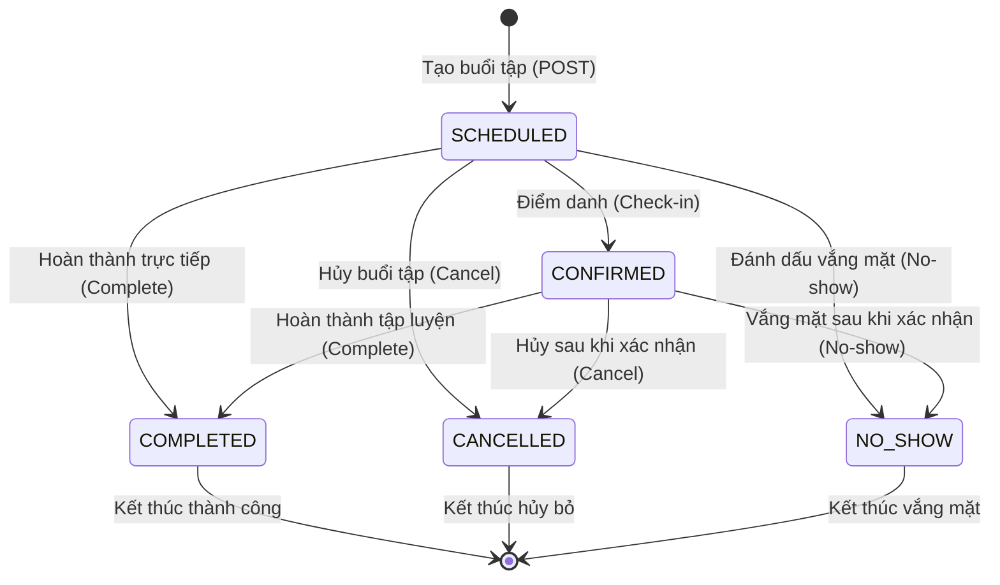

# Data Model: Training Session Management & PT Calendar

**Feature**: `002-pt-session-calendar`  
**Date**: 2026-11-03  
**Status**: Completed  

---

## 1. Domain Entities & Enums

### 1.1. `TrainingSessionEntity` (Domain Entity)

Đại diện cho buổi tập thể hình cá nhân giữa PT và Học viên.  
Package: `x10.zenfit.mvp.service.common.domain.entities.session`

```java
public class TrainingSessionEntity {
    private String id;
    private String clientId;
    private String trainerId;
    private String contractId;
    private String sessionName;
    private LocalDate trainingDate;
    private LocalTime startTime;
    private LocalDateTime endTime;
    private TrainingSessionStatus status;
    private LocalDateTime checkInAt;
    private LocalDateTime completedAt;
    private List<String> evidenceImageUrls;
    private String note;
    private LocalDateTime createdAt;
    private LocalDateTime updatedAt;
}
```

*Quy tắc*: `endTime` là kiểu `LocalDateTime`. Nếu client không truyền, hệ thống tự động gán mặc định `LocalDateTime.of(trainingDate, startTime).plusHours(1)`. Tuyệt đối không chứa annotation Spring Data MongoDB.

### 1.2. `TrainingSessionStatus` (Domain Enum)

Package: `x10.zenfit.mvp.service.common.domain.enums`

```java
public enum TrainingSessionStatus {
    SCHEDULED,   // Buổi tập đã lên lịch, chưa diễn ra
    COMPLETED,   // Buổi tập đã hoàn thành tập luyện (tự động trừ 1 buổi trong hợp đồng PT liên kết)
    CANCELLED,   // Buổi tập đã bị hủy bỏ
    NO_SHOW      // Học viên vắng mặt không lý do
}
```

---

## 2. Persistence Model (MongoDB)

### 2.1. `TrainingSessionDocument`

Package: `x10.zenfit.mvp.service.infrastructure.session.db.mongodb`  
Collection: `training_sessions`

```java
@Data
@Builder
@NoArgsConstructor
@AllArgsConstructor
@Document(collection = "training_sessions")
public class TrainingSessionDocument {

    @Id
    private String id;

    @Indexed
    private String clientId;

    @Indexed
    private String trainerId;

    @Indexed
    private String contractId;

    private String sessionName;

    @Indexed
    private LocalDate trainingDate;

    private LocalTime startTime;

    private LocalDateTime endTime;

    private TrainingSessionStatus status;

    private LocalDateTime checkInAt;

    private LocalDateTime completedAt;

    private String note;

    private LocalDateTime createdAt;

    private LocalDateTime updatedAt;
}
```

### 2.2. MongoDB Indexes Thiết kế

1. **Compound Index 1 (Kiểm tra xung đột lịch PT)**:
   - `{ "trainerId": 1, "trainingDate": 1, "startTime": 1 }`
   - Mục đích: Tìm kiếm cực nhanh xem PT có buổi tập nào trùng ngày và giờ hay không.
2. **Compound Index 2 (Kiểm tra xung đột lịch Học viên)**:
   - `{ "clientId": 1, "trainingDate": 1, "startTime": 1 }`
   - Mục đích: Tìm kiếm cực nhanh xem Học viên có buổi tập nào trùng ngày và giờ hay không.
3. **Compound Index 3 (Truy vấn Calendar theo khoảng ngày)**:
   - `{ "trainerId": 1, "trainingDate": 1 }`
   - Mục đích: Tối ưu hóa truy vấn xem lịch Ngày, Tuần, Tháng của PT.
4. **Single Index**:
   - `{ "contractId": 1 }`: Phục vụ truy vấn các buổi tập gắn với một hợp đồng cụ thể.

---

## 3. Data Transfer Objects (DTO)

### 3.1. `CreateTrainingSessionRequest`

```java
public class CreateTrainingSessionRequest {
    @NotBlank(message = "Mã học viên không được để trống")
    private String clientId;

    private String trainerId; // Tùy chọn nếu PT đăng nhập; bắt buộc nếu ADMIN tạo

    @NotBlank(message = "Mã hợp đồng không được để trống")
    private String contractId;

    @NotBlank(message = "Tên buổi tập không được để trống")
    @Size(max = 100, message = "Tên buổi tập tối đa 100 ký tự")
    private String sessionName;

    @NotNull(message = "Ngày tập không được để trống")
    private LocalDate trainingDate;

    @NotNull(message = "Giờ bắt đầu không được để trống")
    private LocalTime startTime;

    // Tùy chọn; mặc định = startTime + 1 giờ
    private LocalDateTime endTime;

    @Size(max = 1000, message = "Ghi chú tối đa 1000 ký tự")
    private String note;
}
```

### 3.2. `UpdateTrainingSessionRequest`

```java
public class UpdateTrainingSessionRequest {
    private String clientId;
    private String trainerId;
    private String contractId;

    @Size(max = 100, message = "Tên buổi tập tối đa 100 ký tự")
    private String sessionName;

    private LocalDate trainingDate;
    private LocalTime startTime;
    private LocalDateTime endTime;
    private List<String> evidenceImageUrls;

    @Size(max = 1000, message = "Ghi chú tối đa 1000 ký tự")
    private String note;
}
```

### 3.3. `CompleteTrainingSessionRequest`

```java
public class CompleteTrainingSessionRequest {
    private List<String> evidenceImageUrls;
    private String note;
}
```

### 3.4. `TrainingSessionResponse` (Chi tiết buổi tập)

```java
public class TrainingSessionResponse {
    private String id;
    private String clientId;
    private String trainerId;
    private String contractId;
    private String sessionName;
    private LocalDate trainingDate;
    private LocalTime startTime;
    private LocalDateTime endTime;
    private TrainingSessionStatus status;
    private LocalDateTime checkInAt;
    private LocalDateTime completedAt;
    private List<String> evidenceImageUrls;
    private String note;
    private LocalDateTime createdAt;
    private LocalDateTime updatedAt;
}
```

### 3.4. DTO Calendar: `TrainingSessionCalendarResponse` & `TrainingSessionCalendarItemResponse`

```java
public class TrainingSessionCalendarResponse {
    private CalendarViewType view;       // DAY, WEEK, MONTH
    private LocalDate startDate;         // Ngày bắt đầu khoảng thời gian
    private LocalDate endDate;           // Ngày kết thúc khoảng thời gian
    private int totalSessions;           // Tổng số buổi tập trong khoảng
    private List<TrainingSessionCalendarItemResponse> sessions;
}

public class TrainingSessionCalendarItemResponse {
    private String id;
    private String clientId;
    private String trainerId;
    private String contractId;
    private String sessionName;
    private LocalDate trainingDate;
    private LocalTime startTime;
    private LocalDateTime endTime;
    private TrainingSessionStatus status;
    private List<String> evidenceImageUrls;
    private String note;
}
```

### 3.5. DTO Danh sách phân trang: `PaginatedTrainingSessionResponse`

```java
public class PaginatedTrainingSessionResponse {
    private List<TrainingSessionResponse> items;
    private int page;
    private int size;
    private long totalElements;
    private int totalPages;
    private boolean first;
    private boolean last;
}
```

---

## 4. State Transitions & Lifecycle



*Quy tắc chuyển đổi*:
- Không cho phép cập nhật thông tin (`PATCH /{id}`) hoặc đổi trạng thái nếu buổi tập đã ở `COMPLETED`, `CANCELLED`, hoặc `NO_SHOW`.
- Thời điểm `completedAt` do server tự sinh bằng `LocalDateTime.now()`.
- Khi bấm Hoàn thành buổi tập (`COMPLETED`), hệ thống tự động trừ 1 buổi trong hợp đồng PT liên kết (`contract.usedSessions + 1`).

---

## 5. Trainer Tasks & Daily Activities Model

### 5.1. `TrainerTaskEntity` (Domain Entity)
Đại diện cho công việc, hoạt động hằng ngày của Huấn luyện viên (PT, Team Manager, Head of Training) như thức dậy, ăn sáng, tập cá nhân, họp team.
Package: `x10.zenfit.mvp.service.common.domain.entities.trainer`

```java
public class TrainerTaskEntity {
    private String id;
    private String trainerId;          // PT sở hữu việc này
    private String title;              // "Thức dậy", "Ăn sáng"
    private String description;
    private String color;              // Màu hiển thị trên lịch
    private LocalDate taskDate;
    private LocalTime startTime;
    private LocalTime endTime;
    private boolean allDay;
    private TrainerTaskStatus status;  // TODO, DONE, SKIPPED
    private LocalDateTime completedAt;
    private LocalDateTime createdAt;
    private LocalDateTime updatedAt;
}
```

### 5.2. `TrainerTaskStatus` (Domain Enum)
```java
public enum TrainerTaskStatus {
    TODO, DONE, SKIPPED
}
```

### 5.3. `TrainerTaskDocument` (MongoDB Document)
Collection: `trainer_tasks`  
Package: `x10.zenfit.mvp.service.infrastructure.trainer.db.mongodb`
Indexes:
- Compound Index: `{ trainerId: 1, taskDate: 1 }`
- Compound Index: `{ trainerId: 1, status: 1 }`

